# [MỤC 2.2.1] SƠ ĐỒ KHỐI KIẾN TRÚC TỔNG THỂ HỆ THỐNG XE DÒ LINE

Tài liệu này đặc tả chi tiết sơ đồ khối kiến trúc phần cứng - phần mềm của xe dò line tự hành sử dụng vi điều khiển ESP32 và MicroPython.

---

## 1. Sơ đồ khối Mermaid (Nền trắng, Chiều ngang, Cỡ chữ 16px)

```mermaid
%%{init: {'theme': 'default', 'themeVariables': {'darkMode': false, 'background': '#FFFFFF', 'mainBkg': '#FFFFFF', 'nodeBkg': '#FFFFFF', 'nodeBorder': '#2563EB', 'nodeTextColor': '#000000', 'lineColor': '#1E293B', 'textColor': '#000000', 'edgeLabelBackground': '#FFFFFF', 'fontSize': '16px'}}}%%
flowchart LR
    %% Định nghĩa Style chuẩn nền trắng, viền đậm màu, chữ đen 16px
    classDef default fill:#FFFFFF,stroke:#2563EB,stroke-width:2px,color:#000000,font-size:16px;
    classDef sensorNode fill:#FFFFFF,stroke:#059669,stroke-width:2px,color:#000000,font-size:16px;
    classDef mcuNode fill:#FFFFFF,stroke:#2563EB,stroke-width:2px,color:#000000,font-size:16px;
    classDef driverNode fill:#FFFFFF,stroke:#D97706,stroke-width:2px,color:#000000,font-size:16px;
    classDef motorNode fill:#FFFFFF,stroke:#B45309,stroke-width:2.5px,color:#000000,font-size:16px,font-weight:bold;
    classDef powerNode fill:#FFFFFF,stroke:#DC2626,stroke-width:2px,color:#000000,font-size:16px;
    classDef iotNode fill:#FFFFFF,stroke:#7C3AED,stroke-width:2px,color:#000000,font-size:16px;
    classDef titleBox fill:#FFFFFF,stroke:#0F172A,stroke-width:2.5px,color:#0F172A,font-size:16px,font-weight:bold;

    %% 1. KHỐI CẢM BIẾN DÒ LINE (INPUT)
    subgraph G_SENSOR["1. KHỐI CẢM BIẾN DÒ LINE"]
        direction TB
        S_ARRAY["Mảng Cảm Biến TCRT5000 5 Kênh<br/>• 5 Cặp LED Hồng Ngoại Thu/Phát<br/>• Mắt S1, S2, S3, S4, S5"]:::sensorNode
        S_SIGNAL["Tín Hiệu Digital Active-Low<br/>• Đen = Mức 0 (0V)<br/>• Trắng = Mức 1 (3.3V)"]:::sensorNode
        S_ARRAY --> S_SIGNAL
    end
    class G_SENSOR titleBox;

    %% 2. KHỐI XỬ LÝ TRUNG TÂM ESP32
    subgraph G_ESP["2. KHỐI ĐIỀU KHIỂN TRUNG TÂM (ESP32 NODEMCU-32S)"]
        direction TB
        subgraph ESP_FIRMWARE["MicroPython OOP Firmware (Xtensa Dual-Core 240MHz)"]
            direction TB
            M_SENSOR["Lớp LineFollowerSensor<br/>• Đảo bit & nén Bitmask 5-bit<br/>• Tra bảng sai số e = -4.0 .. +4.0<br/>• Cứu vạch mất: Giữ last_valid_error"]:::mcuNode
            M_PID["Lớp LineTracker (Vòng Lặp 100Hz)<br/>• Lọc thông thấp: α = 0.85<br/>• Bộ điều khiển PID + Zero-Crossing<br/>• Thuật toán Bơm cua gắt 90% / -65%"]:::mcuNode
            M_MOTOR["Lớp MotorDriver<br/>• Xung mồi Kickstart: 98% / 70ms<br/>• Xuất PWM 10-bit (0..1023)<br/>• Tần số 1000Hz chống rít động cơ"]:::mcuNode
            M_NET["Lớp WebControlServer & WiFiStationClient<br/>• Wi-Fi STA kết nối Hotspot<br/>• Socket Non-blocking HTTP Port 80<br/>• API Điều khiển & Telemetry JSON"]:::mcuNode
            M_SENSOR --> M_PID --> M_MOTOR
        end
    end
    class G_ESP,ESP_FIRMWARE titleBox;

    %% 3. KHỐI MẠCH CÔNG SUẤT (TB6612FNG)
    subgraph G_DRIVER["3. KHỐI DRIVER ĐỘNG CƠ"]
        direction TB
        DRV_CHIP["Mạch Cầu H Dual-MOSFET TB6612FNG<br/>• Dòng tải 1.2A liên tục (3.2A đỉnh)<br/>• Chân STBY kích hoạt IC mức cao"]:::driverNode
        DRV_IN["Cổng Điều Khiển Logic & PWM<br/>• Kênh A (Trái): AIN1, AIN2<br/>• Kênh B (Phải): BIN1, BIN2"]:::driverNode
        DRV_IN --> DRV_CHIP
    end
    class G_DRIVER titleBox;

    %% 4. KHỐI CƠ CẤU CHẤP HÀNH
    subgraph G_ACTUATOR["4. CƠ CẤU CHẤP HÀNH"]
        direction TB
        MOTORS["02 Động Cơ DC Giảm Tốc TT (1:48)<br/>• Bánh Trái (AO1, AO2)<br/>• Bánh Phải (BO1, BO2)"]:::motorNode
        WHEELS["Hệ Dẫn Động Vi Sai 2 Bánh<br/>• 02 Bánh Cao Su Chịu Lực<br/>• 01 Bánh Đa Hướng Omni Dẫn Hướng"]:::motorNode
        MOTORS --> WHEELS
    end
    class G_ACTUATOR titleBox;

    %% 5. KHỐI NGUỒN NĂNG LƯỢNG
    subgraph G_POWER["5. KHỐI NGUỒN CẤP ĐIỆN TOÀN XE"]
        direction TB
        BATTERY["Khối Nguồn Pin 2S 18650 (7.4V - 8.4V)<br/>• Dung lượng 4000mAh + Công tắc nguồn"]:::powerNode
        BUS_VM["Tuyến Nguồn Động Lực (VM: 7.4V - 8.4V)<br/>• Cấp trực tiếp cho Mạch Cầu H TB6612FNG"]:::powerNode
        BUS_VCC["Tuyến Ổn Áp Logic (VCC: 5.0V / 3.3V)<br/>• Shield S-V-G cấp nguồn ESP32 & TCRT5000"]:::powerNode
        BATTERY --> BUS_VM
        BATTERY --> BUS_VCC
    end
    class G_POWER titleBox;

    %% 6. KHỐI GIÁM SÁT & ĐIỀU KHIỂN TỪ XA
    subgraph G_IOT["6. GIÁM SÁT & WEB DASHBOARD CLOUD"]
        direction TB
        WEB_UI["Giao Diện Web HUD (HTML5 / CSS / JS)<br/>• Giám sát trạng thái 5 mắt TCRT5000<br/>• Hiển thị sai số e, tốc độ PWM realtime<br/>• Phím ST-BY chạy/dừng & Bản đồ 2D Canvas"]:::iotNode
        CLOUD_NGROK["Đường Hầm Ngrok Tunnel<br/>• Domain tĩnh HTTPS cố định<br/>• Điều khiển và giám sát qua Internet"]:::iotNode
        CLOUD_NGROK <--> WEB_UI
    end
    class G_IOT titleBox;

    %% LIÊN KẾT LUỒNG DỮ LIỆU & TÍN HIỆU
    S_SIGNAL == "5 Chân GPIO (21, 19, 18, 5, 17)<br/>Active-Low Digital" ==> M_SENSOR
    M_MOTOR == "4 Kênh PWM 1kHz (D13, D14, D27, D26)<br/>Tín hiệu điều tốc & đảo chiều" ==> DRV_IN
    DRV_CHIP == "Điện áp công suất VM (0 - 8.4V)<br/>Dòng động lực AO/BO" ==> MOTORS

    %% LIÊN KẾT TRUYỀN THÔNG WI-FI / HTTP
    M_NET <== "Giao tiếp HTTP REST / JSON<br/>Wi-Fi 2.4GHz 802.11 b/g/n" ==> CLOUD_NGROK

    %% LIÊN KẾT ĐƯỜNG NGUỒN
    BUS_VM -. "Động lực 7.4V-8.4V (VM)" .-> DRV_CHIP
    BUS_VCC -. "Nguồn 5V / 3.3V (VCC)" .-> S_ARRAY
    BUS_VCC -. "Nguồn 5V (Vin)" .-> G_ESP
```

---

## 2. Thuyết minh vai trò của từng khối kỹ thuật

1. **Khối Cảm biến (TCRT5000 5 Kênh)**: Đặt phía trước xe cách mặt sàn $5 - 10\text{ mm}$, gồm 5 cặp LED hồng ngoại và transistor quang thu tín hiệu phản xạ từ bề mặt line đen / nền trắng.
2. **Khối Điều khiển Trung tâm (ESP32 NodeMCU-32S)**: Vi điều khiển 32-bit lõi kép 240MHz chạy firmware MicroPython, tích hợp toàn bộ các lớp đối tượng OOP quản lý cảm biến, tính toán PID 100Hz, phát xung PWM và Web Server Non-blocking.
3. **Khối Mạch Công suất (TB6612FNG)**: IC driver cầu H kép hiệu suất cao MOSFET (thay thế L298N cồng kềnh tỏa nhiệt), nhận 4 kênh xung PWM 1kHz từ ESP32 để cấp nguồn động lực tương ứng cho 2 động cơ DC.
4. **Cơ cấu Chấp hành**: 02 động cơ DC giảm tốc TT (tỷ số truyền 1:48) dẫn động bánh trái và bánh phải độc lập theo nguyên lý lái vi sai (Differential Steering).
5. **Khối Cấp nguồn**: Bộ 2 cell pin 18650 mắc nối tiếp (7.4V - 8.4V) phân tách làm 2 tuyến nguồn: tuyến động lực $V_M$ cấp cho động cơ và tuyến ổn áp hạ áp 5V cấp cho vi điều khiển ESP32, bảo vệ chip khỏi sụt áp và nhiễu do chổi than động cơ.
6. **Khối Giám sát & Điều khiển Không dây (Web Dashboard & Ngrok Tunnel)**: Cho phép người vận hành truy cập giao diện giám sát vi sai, đọc thông số cảm biến thời gian thực và cấu hình hệ số PID thông qua máy tính hoặc điện thoại thông minh từ bất cứ đâu qua Internet.
