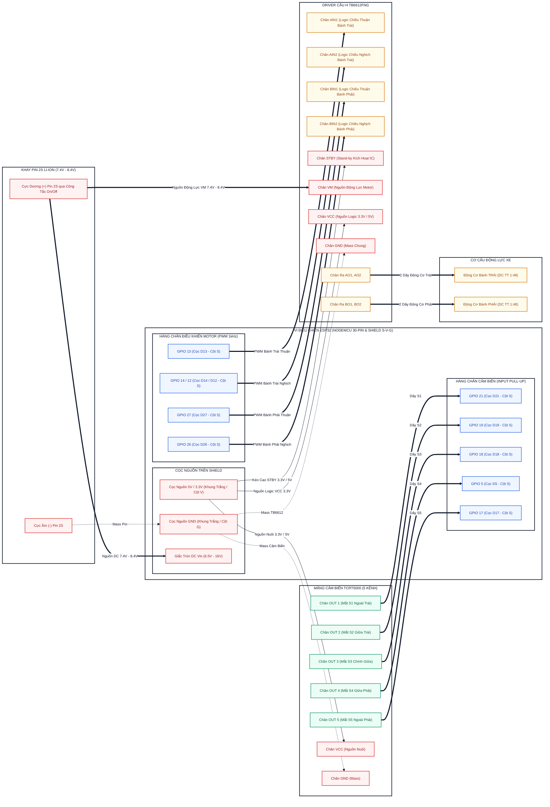

# Sơ Đồ Đấu Nối Chân Chi Tiết ESP32 (Mermaid Wiring Diagram)

Sơ đồ chi tiết đấu nối các chân GPIO của vi điều khiển ESP32 với Mảng 5 mắt cảm biến TCRT5000, Mạch công suất cầu H TB6612FNG, Động cơ DC và Khay Pin 2S 18650.

