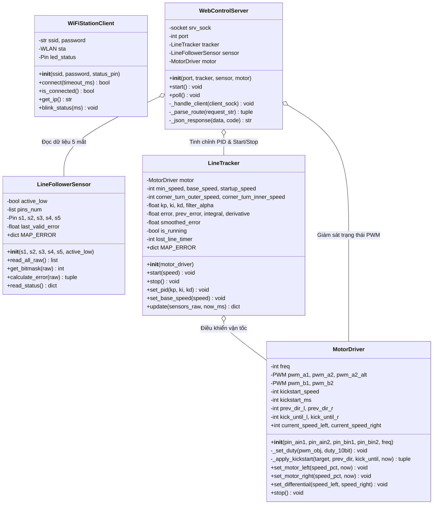
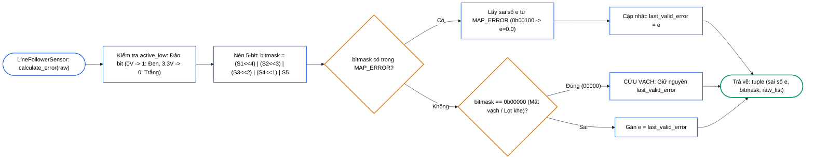
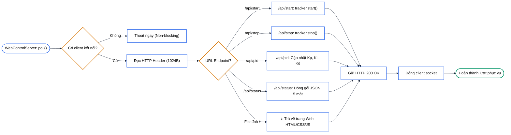
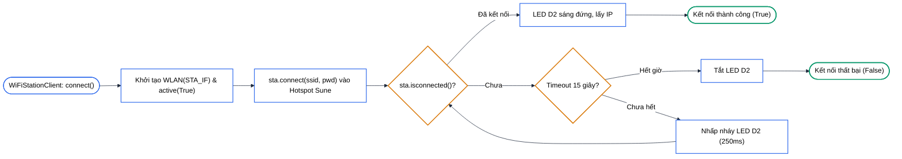

# Sơ Đồ Chi Tiết Từng Lớp Hướng Đối Tượng (Mermaid Nền Trắng Thuần - Chiều Ngang)

---

## 1. Class `LineFollowerSensor`

---

## 2. Class `MotorDriver`

```mermaid
%%{init: {'theme': 'default', 'themeVariables': {'darkMode': false, 'background': '#FFFFFF', 'mainBkg': '#FFFFFF', 'nodeBkg': '#FFFFFF', 'nodeBorder': '#2563EB', 'nodeTextColor': '#000000', 'lineColor': '#1E293B', 'textColor': '#000000', 'edgeLabelBackground': '#FFFFFF'}}}%%
flowchart LR
    classDef default fill:#FFFFFF,stroke:#2563EB,stroke-width:1.5px,color:#000000;
    classDef step fill:#FFFFFF,stroke:#2563EB,stroke-width:1.5px,color:#000000;
    classDef cond fill:#FFFFFF,stroke:#D97706,stroke-width:2px,color:#000000;
    classDef special fill:#FFFFFF,stroke:#DC2626,stroke-width:2px,color:#000000;
    classDef final fill:#FFFFFF,stroke:#059669,stroke-width:2px,color:#000000;

    M_START(["MotorDriver: _apply_kickstart()"]):::default
    M_ZERO{"target_pct == 0?"}:::cond
    M_STOP["Dừng xe: Duty = 0"]:::step

    M_DIR["Xác định chiều quay: cur_dir = +1 hoặc -1"]:::step
    M_CHANGE{"Đổi chiều hoặc khởi hành từ 0?"}:::cond

    M_TRIG["KÍCH HOẠT XUNG MỒI: kick_until = now + 70ms"]:::special
    M_CHECK_WINDOW{"now < kick_until?"}:::cond

    M_BOOST["PHÓNG XUNG 98%: actual_pct = 98%"]:::special
    M_NORMAL["HẠ VỀ TARGET: actual_pct = target_pct"]:::step

    M_PWM["Quy đổi Duty 10-bit (0..1023)"]:::step
    M_HW["Băm xung LEDC 1kHz ra AIN/BIN"]:::step
    M_END(["Hoàn thành cập nhật động cơ"]):::final

    M_START --> M_ZERO
    M_ZERO -- "Đúng" --> M_STOP --> M_PWM
    M_ZERO -- "Sai" --> M_DIR --> M_CHANGE
    M_CHANGE -- "Đúng" --> M_TRIG --> M_CHECK_WINDOW
    M_CHANGE -- "Không" --> M_CHECK_WINDOW
    M_CHECK_WINDOW -- "Trong 70ms" --> M_BOOST --> M_PWM
    M_CHECK_WINDOW -- "Hết 70ms" --> M_NORMAL --> M_PWM
    M_PWM --> M_HW --> M_END
```

---

## 3. Class `LineTracker`

```mermaid
%%{init: {'theme': 'default', 'themeVariables': {'darkMode': false, 'background': '#FFFFFF', 'mainBkg': '#FFFFFF', 'nodeBkg': '#FFFFFF', 'nodeBorder': '#2563EB', 'nodeTextColor': '#000000', 'lineColor': '#1E293B', 'textColor': '#000000', 'edgeLabelBackground': '#FFFFFF'}}}%%
flowchart LR
    classDef default fill:#FFFFFF,stroke:#2563EB,stroke-width:1.5px,color:#000000;
    classDef step fill:#FFFFFF,stroke:#2563EB,stroke-width:1.5px,color:#000000;
    classDef cond fill:#FFFFFF,stroke:#D97706,stroke-width:2px,color:#000000;
    classDef special fill:#FFFFFF,stroke:#DC2626,stroke-width:2px,color:#000000;
    classDef final fill:#FFFFFF,stroke:#059669,stroke-width:2px,color:#000000;

    T_START(["LineTracker: update()"]):::default
    T_LPF["Lọc thông thấp: e_smooth = 0.85*e_raw + 0.15*e_prev"]:::step
    T_DIFF["Tính đạo hàm: de/dt = (e_smooth - prev_error) / dt"]:::step
    
    T_CHECK_ZERO{"Xe qua tâm (|e| < 0.1)?"}:::cond
    T_RESET_I["Zero-Crossing Reset: integral = 0"]:::step
    T_ACC_I["Tích lũy sai số: integral += e * dt"]:::step

    T_PID["Tính bù: u = Kp*e + Ki*integral + Kd*derivative"]:::step
    T_CHECK_CURVE{"Độ lệch |e_smooth|?"}:::cond

    T_CORNER["BƠM CUA GẮT (|e| >= 3.2): Ngoài 90%, Trong -65%"]:::special
    T_MID["BẺ LÁI VỪA (1.5 <= |e| < 3.2): Ngoài 78%, Trong 0%"]:::step
    T_NORMAL["BÁM TÂM PID (|e| < 1.5): Trái = Base - u, Phải = Base + u"]:::step

    T_SEND["motor.set_differential(V_Trái, V_Phải)"]:::step
    T_END(["Trả về Telemetry dict"]):::final

    T_START --> T_LPF --> T_DIFF --> T_CHECK_ZERO
    T_CHECK_ZERO -- "Đúng" --> T_RESET_I --> T_PID
    T_CHECK_ZERO -- "Sai" --> T_ACC_I --> T_PID
    T_PID --> T_CHECK_CURVE
    T_CHECK_CURVE -- ">= 3.2" --> T_CORNER --> T_SEND
    T_CHECK_CURVE -- "1.5..3.2" --> T_MID --> T_SEND
    T_CHECK_CURVE -- "< 1.5" --> T_NORMAL --> T_SEND
    T_SEND --> T_END
```

---

## 4. Class `WebControlServer`

---

## 5. Class `WiFiStationClient`

