# Lưu Đồ Thuật Toán Điều Khiển Hệ Thống Xe Dò Line (Mermaid Flowchart)

Tài liệu mô tả lưu đồ giải thuật điều phối thời gian thực 100Hz của xe dò line tự hành ESP32 trong `firmware/main.py` kết hợp các lớp OOP (`LineTracker`, `MotorDriver`, `WebControlServer`).

```mermaid
%%{init: {'theme': 'base', 'themeVariables': { 'background': '#FFFFFF', 'primaryColor': '#FFFFFF', 'primaryTextColor': '#0F172A', 'primaryBorderColor': '#1E293B', 'lineColor': '#0F172A', 'clusterBkg': '#FFFFFF', 'clusterBorder': '#475569', 'edgeLabelBackground': '#FFFFFF', 'textColor': '#0F172A', 'fontSize': '12px' }}}%%
flowchart TD
    %% Định nghĩa Styles
    classDef startEnd fill:#FFFFFF,stroke:#0F172A,stroke-width:2.5px,color:#0F172A,font-weight:bold;
    classDef process fill:#FFFFFF,stroke:#2563EB,stroke-width:1.5px,color:#0F172A;
    classDef decision fill:#FFFFFF,stroke:#D97706,stroke-width:2px,color:#0F172A;
    classDef special fill:#FFFFFF,stroke:#DC2626,stroke-width:2px,color:#991B1B,font-weight:bold;
    classDef webTask fill:#FFFFFF,stroke:#7C3AED,stroke-width:1.5px,color:#0F172A;
    classDef subGraphStyle fill:#FFFFFF,stroke:#64748B,stroke-width:2px,color:#0F172A;

    %% 1. KHỞI ĐỘNG HỆ THỐNG
    START(["BẮT ĐẦU: Bật công tắc nguồn Pin 2S (7.4V - 8.4V)"]):::startEnd
    INIT_SAFE["Kéo 4 chân Motor PWM về mức LOW 0V để chống giật xe"]:::process
    INIT_WIFI["Quét và kết nối Wi-Fi Hotspot Sune qua Station Mode"]:::process
    CHECK_WIFI{"Wi-Fi kết nối thành công?"}:::decision
    WIFI_OK["Bật LED D2 sáng đứng, khởi tạo địa chỉ IP"]:::process
    INIT_OOP["Khởi tạo các đối tượng OOP: Sensor, MotorDriver, Tracker, WebServer"]:::process

    START --> INIT_SAFE
    INIT_SAFE --> INIT_WIFI
    INIT_WIFI --> CHECK_WIFI
    CHECK_WIFI -- "Chưa" --> INIT_WIFI
    CHECK_WIFI -- "Đã kết nối" --> WIFI_OK
    WIFI_OK --> INIT_OOP

    %% 2. VÒNG LẶP THỜI GIAN THỰC (MAIN EVENT LOOP)
    subgraph LOOP["VÒNG LẶP THỜI GIAN THỰC (WHILE TRUE)"]
        direction TB

        CHECK_TIMER{"Đủ chu kỳ 10ms (100Hz) & Xe đang Bật?"}:::decision

        %% NHÁNH ĐIỀU KHIỂN PID 100HZ
        subgraph PID_CONTROL["CHU TRÌNH ĐIỀU KHIỂN PID (ƯU TIÊN 1)"]
            direction TB
            READ_RAW["Đọc thô 5 kênh cảm biến TCRT5000 (Active-Low)"]:::process
            PACK_MASK["Đảo bit và nén thành Bitmask 5-bit: 0b00000..0b11111"]:::process
            CALC_ERR["Tra cứu sai số vị trí thô e_raw thuộc -4.0 .. +4.0"]:::process
            FILTER["Lọc thông thấp bậc 1: e_smooth = 0.85*e_raw + 0.15*e_prev"]:::process
            
            CHECK_SPECIAL{"Phân loại trạng thái vạch"}:::decision
            
            BOOST["BƠM CUA GẮT: Bánh ngoài 90%, Bánh trong -65%"]:::special
            RECOVER["CỨU VẠCH LỌT KHE: Giữ nguyên sai số cũ e_last"]:::process
            FINISH["VẠCH ĐÍCH: Hãm dừng xe hoặc tăng tốc vượt đích"]:::special
            
            CALC_PID["Tính bộ điều khiển PID: u = Kp*e + Ki*∫e + Kd*de/dt"]:::process
            MIX_SPEED["Tính vận tốc 2 bánh: V_Trái = V_Base - u, V_Phải = V_Base + u"]:::process
            KICKSTART["Áp dụng Xung mồi Kickstart 98% trong 70ms nếu đổi chiều"]:::process
            OUT_PWM["Xuất 4 kênh PWM 1kHz điều khiển Driver TB6612FNG"]:::process

            READ_RAW --> PACK_MASK
            PACK_MASK --> CALC_ERR
            CALC_ERR --> FILTER
            FILTER --> CHECK_SPECIAL

            CHECK_SPECIAL -- "Cua gắt |e| >= 3.2" --> BOOST
            CHECK_SPECIAL -- "Mất vạch 0b00000" --> RECOVER
            CHECK_SPECIAL -- "Vạch đích 0b11111" --> FINISH
            CHECK_SPECIAL -- "Vạch bình thường" --> CALC_PID

            BOOST --> MIX_SPEED
            RECOVER --> CALC_PID
            FINISH --> MIX_SPEED
            CALC_PID --> MIX_SPEED
            MIX_SPEED --> KICKSTART
            KICKSTART --> OUT_PWM
        end

        %% NHÁNH MÁY CHỦ WEB BẤT ĐỒNG BỘ
        subgraph WEB_SERVER["TÁC VỤ WEB SERVER & CLOUD (ƯU TIÊN 2)"]
            direction TB
            POLL_SOCKET["Lắng nghe yêu cầu HTTP kết nối đến cổng 80 (Non-blocking)"]:::webTask
            CHECK_REQ{"Có Client gửi yêu cầu?"}:::decision
            PARSE_API["Giải mã URL Endpoint: /api/start, /api/stop, /api/pid"]:::webTask
            RESP_JSON["Cập nhật cờ hệ thống & Đóng gói JSON gửi Telemetry"]:::webTask

            POLL_SOCKET --> CHECK_REQ
            CHECK_REQ -- "Có" --> PARSE_API
            PARSE_API --> RESP_JSON
            CHECK_REQ -- "Không" --> YIELD_CPU
        end

        YIELD_CPU["Nghỉ 1 mili-giây: time.sleep_ms(1)"]:::process
    end
    class LOOP,PID_CONTROL,WEB_SERVER subGraphStyle;

    INIT_OOP --> CHECK_TIMER
    CHECK_TIMER -- "Có (Đủ 10ms & Active)" --> READ_RAW
    CHECK_TIMER -- "Không (Stand-by / Chưa đủ 10ms)" --> POLL_SOCKET
    OUT_PWM --> POLL_SOCKET
    RESP_JSON --> YIELD_CPU
    YIELD_CPU --> CHECK_TIMER
```

